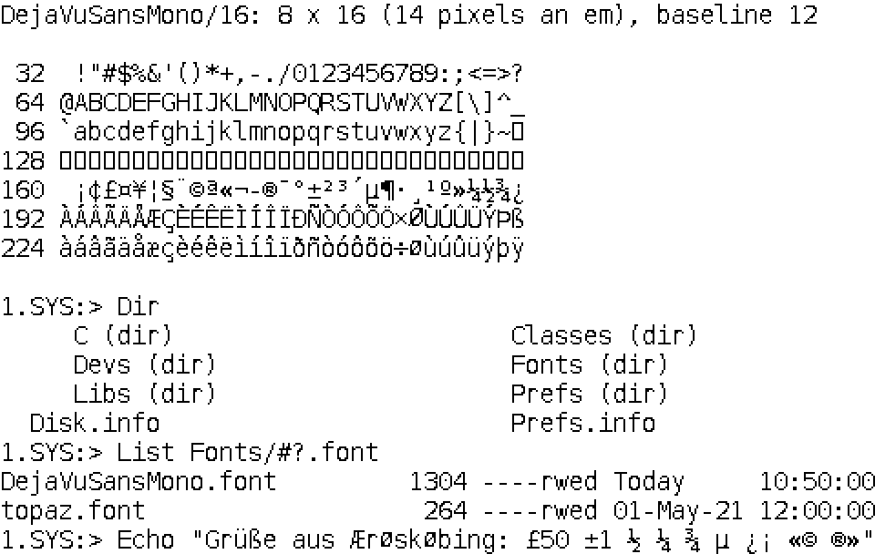

# Amiga bitmap fonts: DejaVu Sans Mono for the Shell

`DejaVuSansMono.font` and its drawer `DejaVuSansMono/` are DejaVu Sans Mono as
Amiga bitmap fonts, in the AmigaOS diskfont format: 12, 14, 16, 18 and 20
pixels high, the Latin-1 characters 32 to 255, fixed width, one bit a pixel.
They are for the Shell: console.device draws in the system default text
(Font prefs), which is topaz 8 when no Font prefs name another, and topaz 8
is tiny on a 1920 x 1200 Workbench.

OpenUp installs them in `FONTS:` (its ShellFont part), and where there are
no Font prefs yet it makes DejaVu Sans Mono the system default text at a
size for the Workbench's height: 16 from 1050 lines (1920 x 1080 and
1920 x 1200), 14 from 900, 12 from 600, 18 from 1350 and 20 from 1600.

| Size | Cell (x by y) | Pixels an em | tf_Baseline | Characters in 1920 pixels | File |
| ---: | --- | ---: | ---: | ---: | ---: |
| 12 | 6 x 12 | 10 | 9 | 320 | 2,808 bytes |
| 14 | 7 x 14 | 11 | 10 | 274 | 3,432 bytes |
| 16 | 8 x 16 | 14 | 12 | 240 | 4,152 bytes |
| 18 | 9 x 18 | 15 | 13 | 213 | 4,968 bytes |
| 20 | 10 x 20 | 17 | 15 | 192 | 5,880 bytes |

The height is the whole line, `tf_YSize`, with room for the capitals'
accents above (A grave) and the descenders below (`_` and `|`). For each
height the largest pixel size at which all of Latin-1 fits is taken.



The other sizes: [12](preview/DejaVuSansMono-12.png),
[14](preview/DejaVuSansMono-14.png), [18](preview/DejaVuSansMono-18.png),
[20](preview/DejaVuSansMono-20.png). Each preview is drawn from the size
file's own glyphs, twice the size, as graphics.library's `Text()` places
them.

## How they are made

```sh
python3 tools/amigafont.py build /usr/share/fonts/truetype/dejavu/DejaVuSansMono.ttf \
    DejaVuSansMono fonts/amiga --preview fonts/amiga/preview
python3 tools/amigafont.py check fonts/amiga/DejaVuSansMono.font
```

[tools/amigafont.py](../../tools/amigafont.py) (MIT) needs Python 3 and
Pillow (`python3-pil`); `check` needs Python 3 alone and runs in the host
tests (`amigafont_check`). The files here were made on 24 October 2026 from
`DejaVuSansMono.ttf` of DejaVu fonts 2.37 (Ubuntu's `fonts-dejavu-mono`
2.37-8build1, sha256
`a54dca07c76d6289e717e75e0a58c0128f6d7269ef3faf76417c9d7d3bba37ab`), with
FreeType 2.14.2 under Pillow 12.1.1. Another FreeType can put a pixel
elsewhere here and there.

**The glyphs** are drawn by FreeType in its monochrome mode, which runs the
font's own TrueType hinting in full, so every stem lands on whole pixels and
has one width in every glyph of a size: one pixel at 12 to 18, two at 20
(`H`, `l`, `n`, `m` and the rest; `|` stays one). `--render threshold:N` draws the anti-aliased glyph and keeps the
pixels of coverage N and more instead; at 12 to 16 pixels that gives stems
one and two pixels wide side by side and drops thin strokes (`|` at 12), so
the hinted mode is the default. OpenFont's own rasteriser is not hinted
(see the README at the top), which is right for its anti-aliased glyphs but
not for one bit a pixel.

A glyph that sticks out of the cell is moved into it: `R` at 12, 14 and 16,
`w` at 14 and `µ` at 12, by one pixel. None is cut. Characters the font
hasn't got (127 and the C1 controls 128 to 159) take the default glyph, a
box the height of the capitals.

## The format

- `DejaVuSansMono.font`: a FontContentsHeader, `FCH_ID` ($0F00), and one
  FontContents a size: the file's name (`DejaVuSansMono/16`) in 256 bytes,
  the height, style 0, flags `FPF_DESIGNED | FPF_DISKFONT` ($42).
- `DejaVuSansMono/<size>`: a load file of one code hunk: `MOVEQ #-1,D0; RTS`,
  the DiskFontHeader (`DFH_ID`, $0F80, its name `DejaVuSansMono.font`) with
  its TextFont, the glyphs as one bit plane (`tf_CharData`, `tf_Modulo`
  bytes a row, a whole number of words) and `tf_CharLoc` (a long a
  character: the glyph's first bit, its width). Fixed width: no
  `FPF_PROPORTIONAL`, no `tf_CharSpace` and no `tf_CharKern`, so every
  character is `tf_XSize` wide, as console.device wants. `HUNK_RELOC32`
  relocates the two node names, `tf_CharData` and `tf_CharLoc`.

## Tried

On a copy of Instance-32 (lab t4-okrom-20261023, the open ROM, Workbench
1920 x 1200, 24 October 2026) the open ROM's diskfont opened every size, and
with the 16 as the system default text a 1240 x 560 Shell window had 154
columns and 32 rows of 8 x 16 cells (topaz 8: 154 and 64); with the 12, 205
and 42. Making the window narrower brought `Dir`'s columns and the long lines
of `List` in to the new width.

## Licence

The fonts are Font Software under the Bitstream Vera licence, with DejaVu's
changes in the public domain: [LICENSE-DejaVu.txt](LICENSE-DejaVu.txt). It
goes wherever the fonts go (OpenUp puts it in
`SYS:Utilities/OpenUp/Licences`). Their name has neither "Bitstream" nor
"Vera" in it, as the licence asks of modified fonts. The tool is the
AmigaChrome Team's, MIT ([LICENSE](../../LICENSE)).
