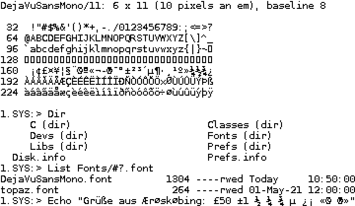

# Amiga bitmap fonts: DejaVu Sans Mono for the Shell

`DejaVuSansMono.font` and its drawer `DejaVuSansMono/` are DejaVu Sans Mono as
Amiga bitmap fonts, in the AmigaOS diskfont format: 8, 9, 10, 11, 12, 13,
14, 16, 18, 20, 22 and 24 pixels high, the Latin-1 characters 32 to 255,
fixed width, one bit a pixel. They are for the Shell: console.device draws in
the system default text (Font prefs' "System default text"), which was topaz
8 when no Font prefs named another, and topaz 8 is tiny on a 1920 x 1200
Workbench.

The 11 is the open ROM's system default text where no Font prefs name one
(the Team, 24 October 2026: "variable sizing, defaults to 11"): the ROM
carries it as graphics.library carries topaz, made with `amigafont.py c`
from the file here. OpenUp installs every size in `FONTS:` (its ShellFont
part), so Font prefs offers them all.

| Size | Cell (x by y) | Pixels an em | tf_Baseline | Characters in 1920 pixels | File |
| ---: | --- | ---: | ---: | ---: | ---: |
| 8 | 5 x 8 | 7 | 5 | 384 | 2,040 bytes |
| 9 | 5 x 9 | 8 | 6 | 384 | 2,160 bytes |
| 10 | 5 x 10 | 8 | 7 | 384 | 2,280 bytes |
| 11 | 6 x 11 | 10 | 8 | 320 | 2,664 bytes |
| 12 | 6 x 12 | 10 | 9 | 320 | 2,808 bytes |
| 13 | 7 x 13 | 11 | 9 | 274 | 3,264 bytes |
| 14 | 7 x 14 | 11 | 10 | 274 | 3,432 bytes |
| 16 | 8 x 16 | 14 | 12 | 240 | 4,152 bytes |
| 18 | 10 x 18 | 16 | 13 | 192 | 5,400 bytes |
| 20 | 11 x 20 | 18 | 15 | 174 | 6,360 bytes |
| 22 | 12 x 22 | 20 | 16 | 160 | 7,416 bytes |
| 24 | 13 x 24 | 22 | 18 | 147 | 8,568 bytes |

The height is the whole line, `tf_YSize`, with room for the descenders below
(`_` and `|`). For each height the largest pixel size at which Latin-1 fits
is taken, leaving out the accented capitals (A grave to Y acute): where their
accents then rise above the line they are brought down onto their letters
(below). Sizes 9 and 10, and 11 and 12, have the same glyphs; the larger of
each pair has a row more between lines.



The other sizes: [8](preview/DejaVuSansMono-8.png),
[9](preview/DejaVuSansMono-9.png), [10](preview/DejaVuSansMono-10.png),
[12](preview/DejaVuSansMono-12.png), [13](preview/DejaVuSansMono-13.png),
[14](preview/DejaVuSansMono-14.png), [16](preview/DejaVuSansMono-16.png),
[18](preview/DejaVuSansMono-18.png), [20](preview/DejaVuSansMono-20.png),
[22](preview/DejaVuSansMono-22.png), [24](preview/DejaVuSansMono-24.png).
Each preview is drawn from the size file's own glyphs, twice the size, as
graphics.library's `Text()` places them.

## How they are made

```sh
python3 tools/amigafont.py build /usr/share/fonts/truetype/dejavu/DejaVuSansMono.ttf \
    DejaVuSansMono fonts/amiga --preview fonts/amiga/preview
python3 tools/amigafont.py check fonts/amiga/DejaVuSansMono.font
python3 tools/amigafont.py c fonts/amiga/DejaVuSansMono.font 11 OUT.h --prefix NAME   # for a ROM
```

[tools/amigafont.py](../../tools/amigafont.py) (MIT) needs Python 3 and
Pillow (`python3-pil`); `check` and `c` need Python 3 alone, and `check`
runs in the host tests (`amigafont_check`). The files here were made on 24
October 2026 from `DejaVuSansMono.ttf` of DejaVu fonts 2.37 (Ubuntu's
`fonts-dejavu-mono` 2.37-8build1, sha256
`a54dca07c76d6289e717e75e0a58c0128f6d7269ef3faf76417c9d7d3bba37ab`), with
FreeType 2.14.2 under Pillow 12.1.1. Another FreeType can put a pixel
elsewhere here and there; with the same ones the build gives the same bytes.

**The glyphs** are drawn by FreeType in its monochrome mode, which runs the
font's own TrueType hinting in full, so every stem lands on whole pixels and
has one width in every glyph of a size: one pixel at 8 to 18, two at 20 to
24. `--render threshold:N` draws the anti-aliased glyph and keeps the pixels
of coverage N and more instead; at 12 to 16 pixels that gives stems one and
two pixels wide side by side and drops thin strokes (`|` at 12), so the
hinted mode is the default. OpenFont's own rasteriser is not hinted (see the
README at the top), which is right for its anti-aliased glyphs but not for
one bit a pixel. At 8 to 10 pixels (7 and 8 an em) the hinting does what it
can: `m` and `W` are tight, and topaz 8 stays the better 8-pixel font.

**The accented capitals** (`--accents squeeze`, the default): where an
accent rises above the line, the blank rows between it and its letter go
first, then rows of the accent that repeat the row under them (a ring keeps
its shape), then its top rows; the letter never moves. That is what makes
the 11 a 6 x 11 font from 10 pixels an em: fitting every accent as drawn
(`--accents fit`) gives 5 x 11 from 8. It brings accents down at 11, 13, 18,
22 and 24 (most capitals), and on `Å` alone at 8 and 20; 12, 14 and 16 are
as before, and 18 and 20 are a pixel an em bigger than they were (10 x 18 and
11 x 20, from 9 x 18 and 10 x 20).

**The width** is the font's advance at that size, or the widest glyph where
one is wider: at 7 pixels an em `M` and `W` are 5 pixels on an advance of 4,
so the 8 has 5-pixel cells. A glyph that sticks out on one side is moved in
by a pixel (`R` at most sizes, `m` and `µ` at 9 and 10, `w` at 13 and 14,
`&` at 24); none is cut. Characters the font hasn't got (127 and the C1
controls 128 to 159) take the default glyph, a box the height of the
capitals.

## The format

- `DejaVuSansMono.font`: a FontContentsHeader, `FCH_ID` ($0F00), and one
  FontContents a size: the file's name (`DejaVuSansMono/16`) in 256 bytes,
  the height, style 0, flags `FPF_DESIGNED | FPF_DISKFONT` ($42).
- `DejaVuSansMono/<size>`: a load file of one code hunk: `MOVEQ #-1,D0; RTS`,
  the DiskFontHeader (`DFH_ID`, $0F80, its name `DejaVuSansMono.font`) with
  its TextFont, the glyphs as one bit plane (`tf_CharData`, `tf_Modulo`
  bytes a row, a whole number of words) and `tf_CharLoc` (a long a
  character: the glyph's first bit, its width). Fixed width: no
  `FPF_PROPORTIONAL`, no `tf_CharSpace` and no `tf_CharKern`, so every
  character is `tf_XSize` wide, as console.device wants. `HUNK_RELOC32`
  relocates the two node names, `tf_CharData` and `tf_CharLoc`.
- `amigafont.py c` writes one size as a C header: the TextFont's fields as
  macros, `tf_CharData` and `tf_CharLoc` as constant arrays.

## Tried

On a copy of Instance-32 (lab t4-okrom-20261023, the open ROM, Workbench
1920 x 1200, 24 October 2026) the open ROM's diskfont opened every size of
the first five, and with the 16 as the system default text a 1240 x 560
Shell window had 154 columns and 32 rows of 8 x 16 cells (topaz 8: 154 and
64); with the 12, 205 and 42. Making the window narrower brought `Dir`'s
columns and the long lines of `List` in to the new width.

## Licence

The fonts are Font Software under the Bitstream Vera licence, with DejaVu's
changes in the public domain: [LICENSE-DejaVu.txt](LICENSE-DejaVu.txt). It
goes wherever the fonts go (OpenUp puts it in
`SYS:Utilities/OpenUp/Licences`; a ROM with the 11 carries it too). Their
name has neither "Bitstream" nor "Vera" in it, as the licence asks of
modified fonts. The tool is the AmigaChrome Team's, MIT
([LICENSE](../../LICENSE)).
